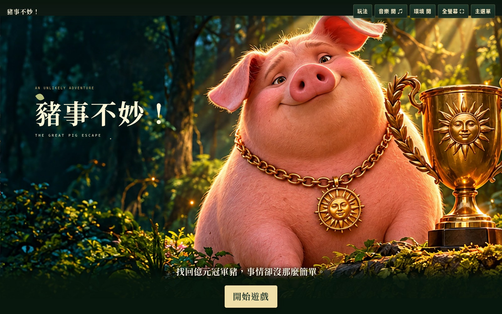

# 豬事不妙！The Great Pig Escape

## 🎮 點此遊玩

### [▶ 開始《豬事不妙！》](https://vitas9313-sketch.github.io/the-great-pig-escape/)

一隻身價上億的冠軍豬逃進森林。你受富豪委託前去尋找，卻捲入一場意想不到的救援冒險。

**三關點擊解謎・雙結局・原創電影動畫風格**

使用電腦瀏覽器開啟連結即可遊玩，不需要下載或安裝。以滑鼠點擊場景與選項；右上角可切換音樂、環境效果與全螢幕。若沒有聲音，點擊右上方音樂按鈕啟動。

*點擊上方連結或首頁圖片，即可進入遊戲。正式展示版以 `main` 為準；下方保留完整專案文件與版本紀錄。*

---

**正式遊戲：`main`｜目前遊戲版號：V1-22。**

## 專案文件

- [遊戲規格書](SPEC.md)：故事、人物、關卡判定、操作、存檔、技術、美術與驗收要求。
- [修改履歷](CHANGELOG.md)：V1-1～V1-22各版需求、實際變更、驗證與限制。
- [原創素材紀錄](ART_SOURCES.md)：圖像來源、生成摘要與檔案雜湊。

遊戲本體為單一 `index.html`；文件與遊戲程式分開維護。

## 版本怎麼選

- **玩最新遊戲：** 使用頁首「點此遊玩」連結；正式網站由 `main` 部署。
- **查某版改了什麼：** 點下表的版本編號，開啟最新版修改履歷中該版的段落。
- **看某版真正的程式：** 點該列「程式碼」，開啟那個Tag的 `index.html`；提交連結可核對修改內容。
- Tag是固定的歷史快照，不是獨立遊戲網址。切換舊Tag時，其README也會回到當時內容；最新文件請回 `main`。
- V2試作Tag與分支已依要求移除；所有V1版本保留，不將舊Tag改指向新程式。

## V1版本一覽

| 版本 | 名稱 | 主要變更 | 程式提交 |
|---|---|---|---|
| [V1-22](CHANGELOG.md#v1-22) **目前最新版** | 還原上一版音樂 | 音樂核心還原V1-19，移除V1-20新增的配樂音軌與開場提示；保留繩索與嘴型修正。 | [程式碼](https://github.com/vitas9313-sketch/the-great-pig-escape/blob/V1-22/index.html) · [5659507](https://github.com/vitas9313-sketch/the-great-pig-escape/commit/5659507c93d88f502376c6bc09ab0ef823d89e02) |
| [V1-21](CHANGELOG.md#v1-21) | 記者近景與繩索連續性 | 救援前專用綑綁近景；記者改用原畫嘴部兩個狀態與停頓，移除橢圓嘴型。 | [程式碼](https://github.com/vitas9313-sketch/the-great-pig-escape/blob/V1-21/index.html) · [d8c0217](https://github.com/vitas9313-sketch/the-great-pig-escape/commit/d8c0217e582b7805cacb1580a4fcfe438a24bf39) |
| [V1-20](CHANGELOG.md#v1-20) | 開場音樂實際輸出修正 | 原曲使用獨立配樂音軌、平滑音量包絡與限制器；明確顯示播放解鎖提示，每次開啟預設啟用音樂。 | [程式碼](https://github.com/vitas9313-sketch/the-great-pig-escape/blob/V1-20/index.html) · [dee7095](https://github.com/vitas9313-sketch/the-great-pig-escape/commit/dee70952af1362686bcca105aef66c94f157f62c) |
| [V1-19](CHANGELOG.md#v1-19) | 音效時機與對話演出 | 提高V1原曲音量、移高追蹤按鈕；新增記者對話框／嘴型、凶狠守衛與結果音樂。 | [程式碼](https://github.com/vitas9313-sketch/the-great-pig-escape/blob/V1-19/index.html) · [d0f14dd](https://github.com/vitas9313-sketch/the-great-pig-escape/commit/d0f14dd550c44b839b2b3211f2739411ba687b1d) |
| [V1-18](CHANGELOG.md#v1-18) | 還原最初V1配樂 | 還原V1-1旋律、節奏與音量；前導下方只留略過按鈕。 | [程式碼](https://github.com/vitas9313-sketch/the-great-pig-escape/blob/V1-18/index.html) · [13f0ec1](https://github.com/vitas9313-sketch/the-great-pig-escape/commit/13f0ec16b02a045f271029914ece8b7988de292a) |
| [V1-17](CHANGELOG.md#v1-17) | 提高配樂與可靠啟動 | 提高原曲音量，修正舊靜音偏好與音訊排程；直接維護main。 | [程式碼](https://github.com/vitas9313-sketch/the-great-pig-escape/blob/V1-17/index.html) · [d1c0c00](https://github.com/vitas9313-sketch/the-great-pig-escape/commit/d1c0c00cc6d231555dedacbfec392a9fde9f1a2f) |
| [V1-16](CHANGELOG.md#v1-16) | 標題背景音樂 | 保留原曲，首次點擊標題畫面即可播放；支援自動播放嘗試與靜音。 | [程式碼](https://github.com/vitas9313-sketch/the-great-pig-escape/blob/V1-16/index.html) · [5f71144](https://github.com/vitas9313-sketch/the-great-pig-escape/commit/5f7114483d839bb0dc86958c7238f51182db24a6) |
| [V1-15](CHANGELOG.md#v1-15) | 場景音樂版本 | 各場景使用原創背景音樂、環境音與事件音效。 | [程式碼](https://github.com/vitas9313-sketch/the-great-pig-escape/blob/V1-15/index.html) · [e3cd4d9](https://github.com/vitas9313-sketch/the-great-pig-escape/commit/e3cd4d965d02dabd49a1bbc37c96b6ebf7f61600) |
| [V1-14](CHANGELOG.md#v1-14) | 全場景保鑣定稿 | 全部11張相關圖統一小眼、銳利眼神、鷹勾鼻、黑色開襟衫與頭頂墨鏡；補齊同行鏡頭。 | [程式碼](https://github.com/vitas9313-sketch/the-great-pig-escape/blob/V1-14/index.html) · [d0351a9](https://github.com/vitas9313-sketch/the-great-pig-escape/commit/d0351a99c72b96247ebc9e6af2d68904f4efa2f8) |
| [V1-13](CHANGELOG.md#v1-13) | 熊／鹿失敗與保鑣區分 | 新增防熊噴霧失敗圖，鹿路線改保鑣，初步統一成熟保鑣造型。 | [程式碼](https://github.com/vitas9313-sketch/the-great-pig-escape/blob/V1-13/index.html) · [fa8a5db](https://github.com/vitas9313-sketch/the-great-pig-escape/commit/fa8a5dbd30c2f59cc2c71f5a9f4c755430a5b247) |
| [V1-12](CHANGELOG.md#v1-12) | 前導與雙結局角色 | 修正實際MP4殘留的背包豬；湖畔與賞金結局加入保鑣和記者。 | [程式碼](https://github.com/vitas9313-sketch/the-great-pig-escape/blob/V1-12/index.html) · [83a278f](https://github.com/vitas9313-sketch/the-great-pig-escape/commit/83a278f85b8b8bbf69fc327acbd2dee6f00d757e) |
| [V1-11](CHANGELOG.md#v1-11) | 直接開始與高畫質羊圈 | 移除開始遊戲覆寫確認，替換羊群逃出羊圈的低解析度圖。 | [程式碼](https://github.com/vitas9313-sketch/the-great-pig-escape/blob/V1-11/index.html) · [d3566b9](https://github.com/vitas9313-sketch/the-great-pig-escape/commit/d3566b99a86e0578f2021a9f7336ea399518b84c) |
| [V1-10](CHANGELOG.md#v1-10) | 足跡與故事連續性 | 修正足跡點擊與重複山洞演出，加入翻覆車輛、落難記者、吃漢堡與同行畫面。 | [程式碼](https://github.com/vitas9313-sketch/the-great-pig-escape/blob/V1-10/index.html) · [5e2e0c6](https://github.com/vitas9313-sketch/the-great-pig-escape/commit/5e2e0c6b40963cb46b04aabc1accf362cd2b3c44) |
| [V1-9](CHANGELOG.md#v1-9) | 字幕、游標與環境音 | 放大統一按鈕、修正游標、加入環境微動／聲音。 | [程式碼](https://github.com/vitas9313-sketch/the-great-pig-escape/blob/V1-9/index.html) · [bcbb1fe](https://github.com/vitas9313-sketch/the-great-pig-escape/commit/bcbb1fe0932d82595fe257981804d334e4940e29) |
| [V1-8](CHANGELOG.md#v1-8) | 穩定前導鏡頭 | 字幕略下移，前導移除持續晃動、平移與縮放。 | [程式碼](https://github.com/vitas9313-sketch/the-great-pig-escape/blob/V1-8/index.html) · [ac414fe](https://github.com/vitas9313-sketch/the-great-pig-escape/commit/ac414fe47a5c45691c194070e552f90868395e39) |
| [V1-7](CHANGELOG.md#v1-7) | 記者命名 | 記者更名為克里斯・培根，統一稱呼。 | [程式碼](https://github.com/vitas9313-sketch/the-great-pig-escape/blob/V1-7/index.html) · [36993f4](https://github.com/vitas9313-sketch/the-great-pig-escape/commit/36993f4ab60325292feb9cf6f560146c00328d4f) |
| [V1-6](CHANGELOG.md#v1-6) | 電腦版與割繩救援 | 固定桌面構圖，失敗回到選擇步驟，新增救援刀與關鍵畫面清晰度修正。 | [程式碼](https://github.com/vitas9313-sketch/the-great-pig-escape/blob/V1-6/index.html) · [a45a619](https://github.com/vitas9313-sketch/the-great-pig-escape/commit/a45a619b36de33959ef49dc0a0beaf9215ebfe80) |
| [V1-5](CHANGELOG.md#v1-5) | 故事銜接與救援選擇 | 補強智能車、記者、背包食物、救援抉擇、字幕與原創聲音。 | [程式碼](https://github.com/vitas9313-sketch/the-great-pig-escape/blob/V1-5/index.html) · [69536e8](https://github.com/vitas9313-sketch/the-great-pig-escape/commit/69536e8e68842b75e497d5cedbf73ce4589291a2) |
| [V1-4](CHANGELOG.md#v1-4) | 蛋糕失敗演出 | 改善對話框可讀性，加入草莓蛋糕撲倒及追兵失敗。 | [程式碼](https://github.com/vitas9313-sketch/the-great-pig-escape/blob/V1-4/index.html) · [1d6ed48](https://github.com/vitas9313-sketch/the-great-pig-escape/commit/1d6ed4893627805d103d93c6cfcefff66313bdc0) |
| [V1-3](CHANGELOG.md#v1-3) | 畫面內操作與全螢幕 | 把操作移入遊戲螢幕，加入全螢幕與失敗重試畫面。 | [程式碼](https://github.com/vitas9313-sketch/the-great-pig-escape/blob/V1-3/index.html) · [4acd802](https://github.com/vitas9313-sketch/the-great-pig-escape/commit/4acd802237b31f67d3f8feb7d14323ced09a30a2) |
| [V1-2](CHANGELOG.md#v1-2) | 原創電影美術與前導 | 加入原創電影動畫風格場景、內嵌前導影片與較合理的選擇結果。 | [程式碼](https://github.com/vitas9313-sketch/the-great-pig-escape/blob/V1-2/index.html) · [caae84d](https://github.com/vitas9313-sketch/the-great-pig-escape/commit/caae84d32ba4aac3a37a62eb51b25d1a79d0a232) |
| [V1-1](CHANGELOG.md#v1-1) | 三關初版 | 完成三關點擊流程、成功／失敗、雙結局與本機存檔。 | [程式碼](https://github.com/vitas9313-sketch/the-great-pig-escape/blob/V1-1/index.html) · [400a11c](https://github.com/vitas9313-sketch/the-great-pig-escape/commit/400a11c9149aea3da5693eeef0789bf1de1c5ebd) |

## V1-22目前內容

- 三關：足跡追蹤 → 洞穴救援 → 食物選擇與湖畔抉擇。
- 野果、蛋糕、熊／鹿錯路與錯誤救援均有失敗結果，可重試；漢堡成功後吃完再同行。
- 富豪賞金與湖畔自由兩種結局，皆算通關。
- 全部保鑣圖採用統一的原創成熟造型，與年輕記者區分。
- 桌面構圖、大字幕、全螢幕、自訂游標、可關閉的原創合成配樂／聲音與環境微動。
- localStorage保存章節檢查點、解鎖、結局與設定；不是跨裝置雲端存檔。
- 圖片、影片與程式皆內嵌於 `index.html`，執行時無框架、CDN或後端。

## 驗證與原創說明

已實測三關、雙結局、失敗重試、存檔與圖像載入；31張內嵌圖可解碼。保鑣定稿更新11張圖，未改遊戲邏輯或前導MP4。本輪另已驗證音樂啟動、靜音與恢復，以及序幕、三關與結局渲染；網站公開連線尚未驗證。

圖像只使用本專案AI原創生成／編修，未下載外部圖片、未指定仿製影劇角色、藝術家或真人演員；音樂與音效由Web Audio API原創合成。詳細來源摘要與雜湊見 [ART_SOURCES.md](ART_SOURCES.md)。

舊植物遊戲仍保留在 `feature/milestone-1`，與本作版本分開，不併入本作V1編號。

## 下載版本的音樂

下載過的index.html不會隨GitHub更新，請重新下載main內最新版。音樂已還原V1-19設定，保留靜音開關；不要求載入即自動出聲。瀏覽器限制時，點擊遊戲或右上方音樂按鈕啟動。
