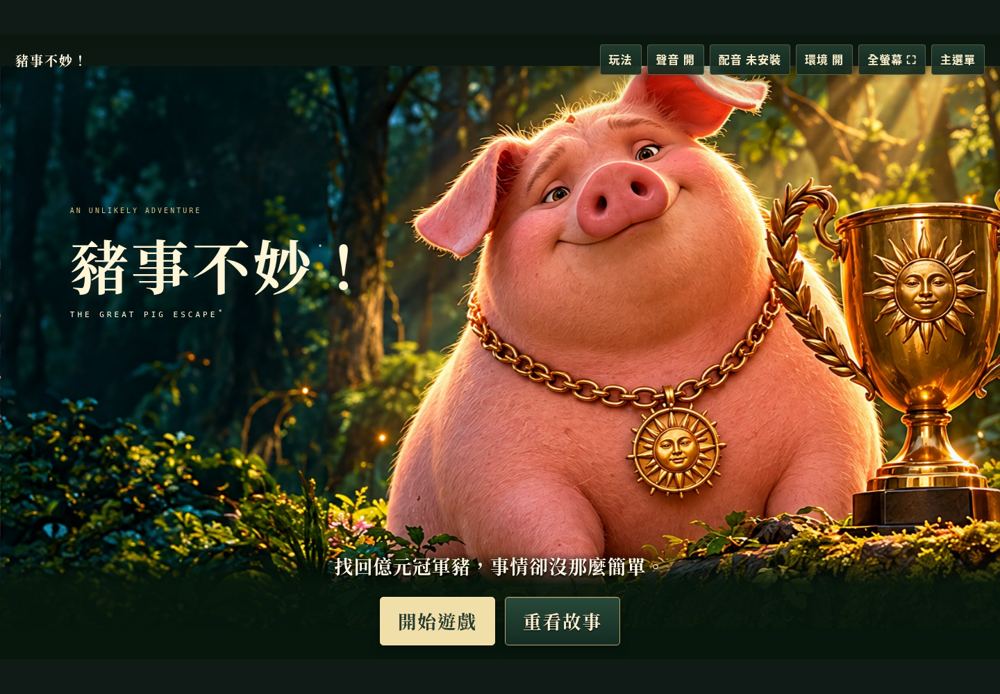
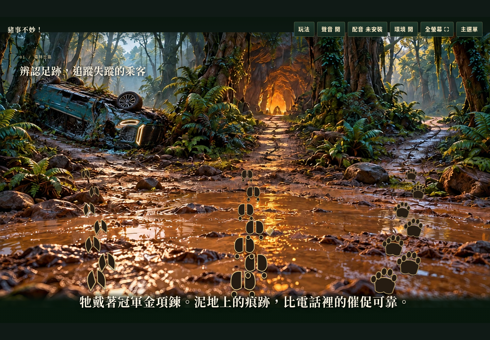
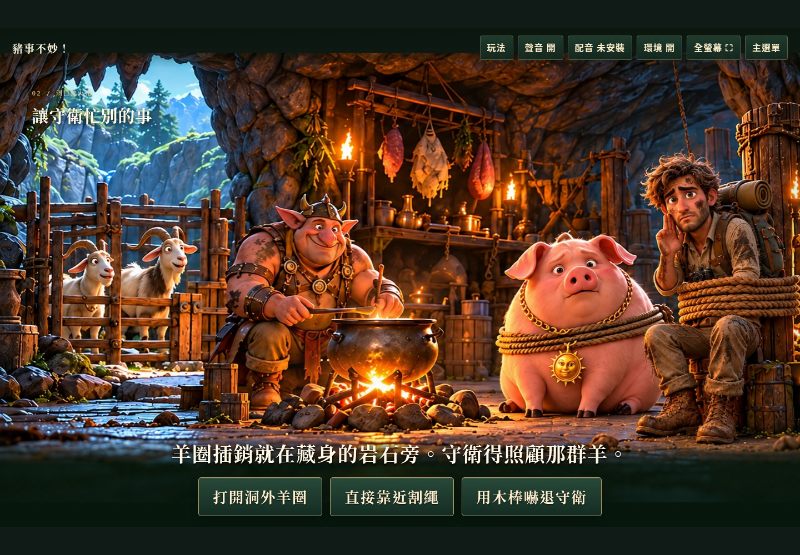
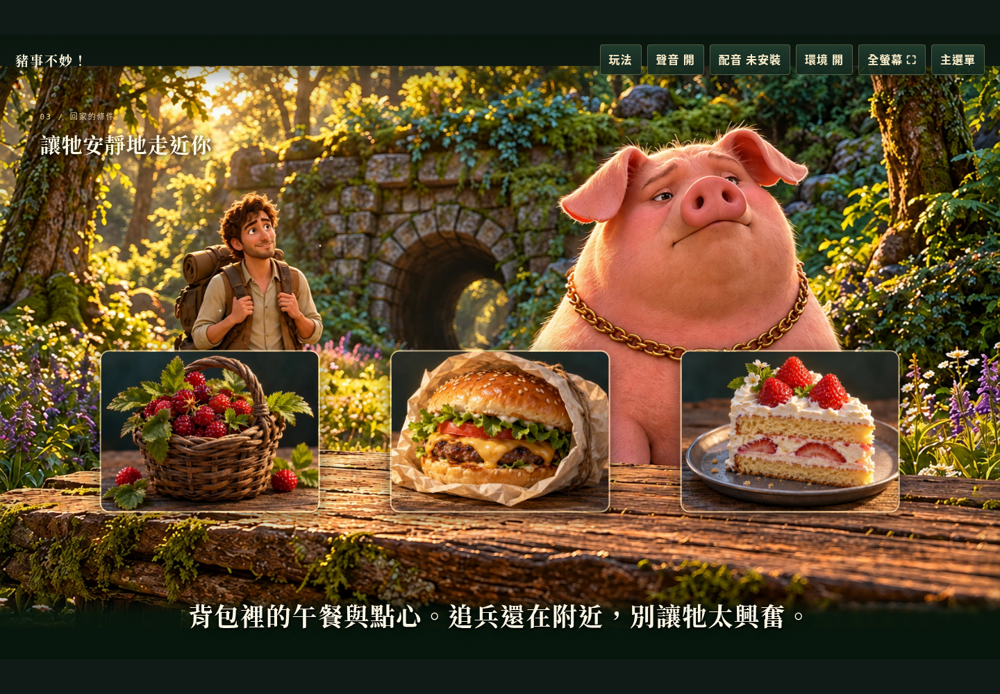

# 《豬事不妙！》作業繳交稿

**正常期限：10/19 23:59；遲交期限：10/20 16:00（台灣時間）。**

以下先提供繳交文字；個人資料、作品網站連結保留欄位，稍後再填。配合目前完成的V1-14撰寫，不把V2試作功能寫成已完成。

## 繳交標題（貼到標題欄）

【學校簡稱】 【學號】 【系級簡稱】 【姓名】 豬事不妙！

將四個括號欄位換成自己的資料。主題可省略。

---

## 以下貼到「文字輸入」區

### 作品名稱

《豬事不妙！》The Great Pig Escape

### 網站連結

作品網址：【稍後填入作品網站連結】

程式碼：https://github.com/vitas9313-sketch/a-terrible-time-to-garden/tree/V1-14

### 規格文字說明

**1. 作品概念與故事**

這是一款以電腦滑鼠點擊操作的三關劇情解謎遊戲。富豪的AI無人智能車在大雨中故障翻覆，唯一乘客——身價上億的冠軍神豬——逃進森林。玩家扮演受委託尋豬的保鑣，循足跡找到洞穴，救出神豬與受困記者，最後決定把豬送回富豪家領賞金，或讓牠在安全湖畔獲得自由。

設計重點是「大幅原創場景＋一句清楚任務＋少量點擊選項」，不加入血量、倒數時間、複雜背包或資源計算。每個選擇都有明確結果，錯誤可重試，兩種最終結局都算通關。

**2. 三關的互動、成功與失敗規則**

| 關卡 | 玩家操作與成功條件 | 失敗與重試 |
|---|---|---|
| 第一關：森林岔路 | 觀察鹿、豬、熊的足跡與金飾線索，選豬蹄印前進，找到山洞 | 鹿路線走錯山頭；熊路線出現保鑣使用防熊噴霧撤退的場景。按「再試一次」重新選擇 |
| 第二關：洞口救援 | 先和記者對話，開羊圈引開守衛，再點擊救援刀熱區，割斷豬與記者身上的繩索 | 直接靠近或用木棒嚇守衛會被抓；只救豬、不救記者也會因呼救被發現。可回到對應救援步驟重試 |
| 第三關：回家的條件 | 食物來自記者背包；漢堡讓豬吃得滿足並乖乖同行，到湖畔再選結局 | 野果讓豬生氣逃走；蛋糕讓豬興奮撲倒保鑣，引來部落。重試回食物選擇，不重播開背包演出 |

富豪結局中，保鑣與記者抱著賞金財寶，神豬戴回皇冠與項鍊；自由結局中，保鑣、記者與神豬在遠離部落的田野湖畔，神豬已取下項鍊。

**3. 介面與技術規格**

- 標題提供開始遊戲、繼續遊戲與重看故事。開始後先播放五幕、約20秒的原創分鏡MP4，搭配字幕與轉場，可略過。
- 使用繁體中文字幕、大型選項、原創滑鼠游標、固定桌面構圖與全螢幕功能；每關有成功畫面，錯誤則顯示「任務失敗／再試一次」。
- 右上方有玩法、聲音、環境微動等控制。背景配樂與煞車、熊吼、鹿鳴、豬呼嚕等聲音由Web Audio API原創合成，可關閉。
- 遊戲主體是單一 `index.html`，HTML、CSS、原生JavaScript與圖片／影片全部內嵌；執行時不依賴框架、CDN或後端，可由GitHub Pages提供。
- 以localStorage保存章節檢查點、解鎖進度、結局與設定；不是跨裝置雲端存檔。失敗重試與繼續遊戲有各自的檢查點規則。
- 若裝置安裝本機台灣華語語音，可開啟朗讀；未安裝仍可使用字幕和原創合成音效。前導屬分鏡剪輯，不宣稱完整逐格角色動畫。

**4. AI協作與反覆修改**

我提出故事、玩法及美術需求，透過AI協助實作並依實際遊玩回饋調整。主要修改包括：將複雜的植物遊戲改成三關點擊冒險；改用放羊引開守衛，改善劇情合理性；修正首次開始誤跳覆寫提示、字幕遮擋足跡、重複過關畫面及重試回錯步驟；加大字幕與按鈕；更新模糊圖片；修正前導殘留的背包豬；統一全部保鑣畫面的小眼、鷹勾鼻、黑色開襟衫造型，與年輕記者區分。Git提交紀錄保留這些修改過程。

**5. 原創素材與驗證**

圖像使用本專案AI原創生成／編修，足跡、游標及部分環境效果由程式繪製；未下載既有電影、遊戲或來源不明的圖片，未指定模仿作品、藝術家或真人演員，也未使用外部音樂包。素材來源、提示詞摘要及檔案雜湊記錄於ART_SOURCES.md。

已使用Chromium實際操作三關、兩種結局及錯誤重試，並檢查存檔、足跡熱區、圖像載入與桌面介面。以下截圖來自實際執行的V1成品，不是美術示意圖。測試機未安裝台灣華語語音，因此未宣稱真實朗讀聽感已驗證。

完整規格：[SPEC.md](SPEC.md)　素材紀錄：[ART_SOURCES.md](../ART_SOURCES.md)

### 網站介面截圖

**圖一：標題與開始遊戲介面**

**圖二：第一關，點選足跡辨認正確路線**

**圖三：第二關，依場景選擇救援方式**

**圖四：第三關，從記者背包取出的食物進行選擇**

---

## 其他截圖（可依需要另外貼入文字區）

- [前導敘事與車禍畫面](screenshots/02-prologue.png)
- [富豪賞金結局](screenshots/06-reward-ending.png)
- [湖畔自由結局](screenshots/07-free-ending.png)
- [熊路線失敗與再試一次](screenshots/08-bear-failure.png)

## 使用方式

只須把標題與上方「文字輸入」區的內容貼到作業系統，不必上傳PDF或附件。複製後檢查圖片是否真的顯示；如果作業系統沒有保留圖片，請開啟對應截圖並複製圖片，使用文字編輯器的插入圖片功能貼入，不能只留圖片檔名或網址。
